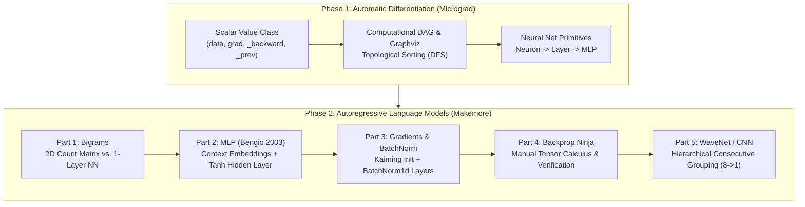

# 🏛️ Neural Network Foundations from Scratch: Micrograd to WaveNet

[](https://www.python.org/)
[](https://pytorch.org/)
[](https://jupyter.org/)
[](CONTRIBUTING.md)
[](LICENSE)

> A rigorous, first-principles journey through modern deep learning foundations implemented from scratch in pure Python and PyTorch. Covering **scalar-valued automatic differentiation**, **computational graph construction**, **character-level autoregressive language modeling**, **manual tensor calculus & backpropagation**, and **hierarchical convolutional neural networks (WaveNet)**.

---

## 📌 Table of Contents

- [Overview & Philosophy](#-overview--philosophy)
- [Curriculum & Learning Journey](#-curriculum--learning-journey)
- [Conceptual Architecture Progression](#-conceptual-architecture-progression)
- [Repository Structure](#-repository-structure)
- [Quickstart & Installation](#-quickstart--installation)
- [Project Overviews](#-project-overviews)
  - [1. Micrograd (Scalar Autograd Engine)](#1-micrograd-scalar-autograd-engine)
  - [2. Makemore (Autoregressive Language Models)](#2-makemore-autoregressive-language-models)
- [Empirical Performance Benchmarks](#-empirical-performance-benchmarks)
- [Study Guide & Recommended Roadmap](#-study-guide--recommended-roadmap)
- [Troubleshooting & Gotchas](#-troubleshooting--gotchas)
- [References & Academic Foundations](#-references--academic-foundations)
- [License](#-license)

---

## 🌟 Overview & Philosophy

Most deep learning practitioners start by calling high-level libraries:
```python
model = nn.Sequential(nn.Linear(10, 20), nn.ReLU(), nn.Linear(20, 1))
loss.backward()
optimizer.step()
```

While convenient, this conceals the mathematical reality of training neural networks. When training becomes unstable, gradients vanish or explode, activations saturate, or loss diverges, a high-level understanding fails.

This repository takes the **first-principles approach**:
1. **No magic black boxes:** Before touching `torch.Tensor`, we build a scalar automatic differentiation engine (`micrograd`) supporting computational DAGs, operator overloading, and topological DFS backpropagation.
2. **From frequency tables to neural nets:** We build autoregressive language models starting with 2D bigram counting matrices and prove mathematically that a linear neural network trained via gradient descent converges to the exact empirical probability matrix.
3. **Internal network dynamics:** We visualize activation distributions, analyze dead neurons caused by saturated $\tanh$ functions, derive **Kaiming/He normal initialization**, and build **Batch Normalization** from scratch.
4. **Becoming a "Backprop Ninja":** We derive manual analytical tensor gradients for cross-entropy and batch normalization, validating every single gradient against PyTorch autograd within machine epsilon ($< 10^{-7}$).
5. **Modern architectures:** We build modular PyTorch-like layer abstractions (`Embedding`, `FlattenConsecutive`, `BatchNorm1d`, `Linear`, `Sequential`) and implement a hierarchical **WaveNet-style convolutional network**.

---

## 🗺️ Curriculum & Learning Journey

| Module | Notebook | Core Concept | Key Techniques | Primary Metric |
|---|---|---|---|:---:|
| **Micrograd** | [`micrograd_first_half.ipynb`](micrograd/micrograd_first_half.ipynb) | Scalar Autograd & DAG | `Value` class, chain rule, Graphviz visualization, topological DFS traversal | Exact match with PyTorch |
| **Micrograd** | [`micrograd__second_half_roughly.ipynb`](micrograd/micrograd__second_half_roughly.ipynb) | Neural Net Abstractions | `Neuron`, `Layer`, `MLP`, MSE loss, optimization loop, verification against PyTorch | Loss drops $6.3 \to 0.0001$ |
| **Makemore 1** | [`makemore_part1_bigrams.ipynb`](makemore/makemore_part1_bigrams.ipynb) | Bigram Language Model | 2D count matrix, Laplace smoothing, 1-layer linear neural net, Softmax, NLL loss | Val Loss: **2.454** |
| **Makemore 2** | [`makemore_part2_mlp.ipynb`](makemore/makemore_part2_mlp.ipynb) | Multilayer Perceptron | Bengio et al. 2003, continuous character embeddings, minibatching, learning rate finder | Val Loss: **2.168** |
| **Makemore 3** | [`makemore_part3_bn.ipynb`](makemore/makemore_part3_bn.ipynb) | Activations & BatchNorm | Hockey-stick loss fix, Kaiming initialization, dead neuron diagnosis, custom `BatchNorm1d` | Val Loss: **2.105** |
| **Makemore 4** | [`makemore_part4_backprop.ipynb`](makemore/makemore_part4_backprop.ipynb) | Manual Tensor Backprop | 16-step forward pass decomposition, manual analytical cross-entropy & batchnorm derivatives | Max diff $< 10^{-7}$ |
| **Makemore 5** | [`makemore_part5_cnn1.ipynb`](makemore/makemore_part5_cnn1.ipynb) | WaveNet & Hierarchical CNN | Consecutive token grouping ($8 \to 4 \to 2 \to 1$), modular layers, 3D batchnorm | Val Loss: **1.993** |

---

## 🧬 Conceptual Architecture Progression



---

## 📁 Repository Structure

```
.
├── README.md                               # Root repository guide (you are here)
├── requirements.txt                        # Python dependencies
├── .gitignore                              # Git exclusion rules
│
├── micrograd/                              # Project 1: Scalar Autograd Engine
│   ├── README.md                           # Detailed Micrograd documentation
│   ├── micrograd_first_half.ipynb          # Scalar autograd engine, DAG, topological sort
│   └── micrograd__second_half_roughly.ipynb# Neuron, Layer, MLP, training loop, PyTorch parity
│
└── makemore/                               # Project 2: Language Models from Scratch
    ├── README.md                           # Detailed Makemore documentation
    ├── names.txt                           # 32,033 names dataset (US SSA records)
    ├── makemore_part1_bigrams.ipynb        # Bigram frequency matrix vs linear neural net
    ├── makemore_part2_mlp.ipynb            # Bengio 2003 MLP, embeddings, learning rate tuning
    ├── makemore_part3_bn.ipynb             # Activations, Kaiming init, BatchNorm1d
    ├── makemore_part4_backprop.ipynb       # "Backprop Ninja": 100% manual tensor gradients
    └── makemore_part5_cnn1.ipynb           # WaveNet architecture & hierarchical convolutions
```

---

## 🚀 Quickstart & Installation

### 1. Clone the Repository
```bash
git clone https://github.com/your-username/nn-foundations-from-scratch.git
cd nn-foundations-from-scratch
```

### 2. Set Up a Virtual Environment
```bash
# On macOS / Linux:
python3 -m venv venv
source venv/bin/activate

# On Windows (PowerShell):
python -m venv venv
.\venv\Scripts\Activate.ps1
```

### 3. Install Dependencies
```bash
pip install -r requirements.txt
```

### 4. Install Graphviz (Required for Micrograd DAG Visualizations)
The Python package `graphviz` requires the underlying system executable:
- **macOS:** `brew install graphviz`
- **Ubuntu/Debian:** `sudo apt-get install graphviz`
- **Windows:** Download from [Graphviz Official Site](https://graphviz.org/download/) or `winget install Graphviz.Graphviz` (make sure it is added to your system `PATH`).

### 5. Launch Jupyter
```bash
jupyter notebook
```

---

## 🔎 Project Overviews

### 1. Micrograd (Scalar Autograd Engine)
📄 **Folder:** [`micrograd/`](micrograd/) | **Docs:** [`micrograd/README.md`](micrograd/README.md)

Micrograd implements a scalar automatic differentiation engine in pure Python. Key highlights:
- **`Value` Object:** Wraps a scalar float, tracks parents in a set (`_prev`), and defines closures (`_backward`) for each primitive operation (`+`, `*`, `tanh`, `pow`, etc.).
- **Multivariate Chain Rule:** Proper accumulation (`+=`) prevents overwriting gradients when variables are referenced multiple times in the expression graph.
- **Topological Sorting:** Recursively resolves the computational DAG to execute backpropagation in reverse topological order.
- **Full Deep Learning Pipeline:** Implements `Neuron`, `Layer`, and `MLP`, calculates Mean Squared Error loss, executes gradient descent, and verifies parity against PyTorch's native `requires_grad=True` autograd engine.

---

### 2. Makemore (Autoregressive Language Models)
📄 **Folder:** [`makemore/`](makemore/) | **Docs:** [`makemore/README.md`](makemore/README.md)

Makemore explores the complete evolutionary tree of autoregressive sequence generation:
- **Part 1 (Bigrams):** Unveils the equivalence between statistical transition counting (Laplace smoothed) and a single linear layer optimized with cross-entropy and negative log likelihood.
- **Part 2 (MLP):** Implements Yoshua Bengio et al. (2003). Projects discrete characters into continuous embedding spaces, concatenates context windows, implements minibatches, and performs learning rate exponential sweeps.
- **Part 3 (Activations & BatchNorm):** Identifies the cause of "hockey stick" initial loss curves, resolves vanishing gradients caused by saturated $\tanh$ activations via Kaiming/He normal initialization, and implements `BatchNorm1d` with running statistics.
- **Part 4 (Backprop Ninja):** Disassembles cross-entropy and batch normalization into 16 micro-operations and manually derives their exact analytical tensor gradients, verifying all gradients against PyTorch with error $< 10^{-7}$.
- **Part 5 (WaveNet):** Replaces flat context concatenation with progressive consecutive grouping ($8 \to 4 \to 2 \to 1$), builds a modular layer framework (`Embedding`, `FlattenConsecutive`, `BatchNorm1d`, `Linear`, `Sequential`), and drives validation loss below 2.0.

---

## 📊 Empirical Performance Benchmarks

All models were evaluated on the 32,033 names dataset:

```
[Uniform Random Baseline]  ======================================== 3.296
[Bigram Linear NN]         ============================== 2.470
[Bigram Count Matrix]      ============================== 2.454
[Bengio MLP (Context=3)]   ========================== 2.168
[MLP + Kaiming + BN]       ========================= 2.105
[WaveNet (Context=8)]      ======================== 1.993 (Sub-2.0 Barrier!)
                           +---------+---------+---------+---------+
                           0.0       1.0       2.0       3.0      Loss
```

| Model | Context Window | Parameter Count | Train Loss | Dev / Val Loss |
|---|:---:|:---:|:---:|:---:|
| **Uniform Random Baseline** | - | - | 3.296 | 3.296 |
| **Bigram Count Matrix** | 1 character | 729 | 2.454 | 2.454 |
| **Bigram Linear Neural Net** | 1 character | 729 | 2.470 | 2.470 |
| **Bengio MLP (Baseline Init)** | 3 characters | 3,481 | 2.124 | 2.168 |
| **MLP + Saturated Tanh Fix** | 3 characters | 12,097 | 2.035 | 2.102 |
| **MLP + Batch Normalization** | 3 characters | 12,524 | 2.066 | 2.105 |
| **Manual Backprop Ninja MLP** | 3 characters | 12,524 | 2.070 | 2.109 |
| **WaveNet (Hierarchical Conv)** | 8 characters | 22,110 | 1.918 | 2.022 |
| **WaveNet (Scaled $d=24, h=128$)** | 8 characters | 76,579 | **1.769** | **1.993** |

---

## 🎓 Study Guide & Recommended Roadmap

If you are a student, self-learner, or preparing for deep learning interviews:

1. **Step 1 — Understand Autodiff:** Work through [`micrograd/micrograd_first_half.ipynb`](micrograd/micrograd_first_half.ipynb). Do not move forward until you can write a `Value` class and its `_backward()` methods from memory.
2. **Step 2 — Connect Math to NNs:** Build an MLP and train it on synthetic data in [`micrograd/micrograd__second_half_roughly.ipynb`](micrograd/micrograd__second_half_roughly.ipynb). Notice how `.grad` resets to `0.0` before each backward pass.
3. **Step 3 — Bridge Statistics and Deep Learning:** Run [`makemore/makemore_part1_bigrams.ipynb`](makemore/makemore_part1_bigrams.ipynb). Understand why counting frequencies and training a single linear layer with cross-entropy converge to identical probabilities.
4. **Step 4 — Embeddings & Multi-Token Context:** Study [`makemore/makemore_part2_mlp.ipynb`](makemore/makemore_part2_mlp.ipynb) to understand why continuous embeddings resolve the curse of dimensionality.
5. **Step 5 — Master Initialization & Normalization:** Dive into [`makemore/makemore_part3_bn.ipynb`](makemore/makemore_part3_bn.ipynb). Pay close attention to the activation histograms and dead neuron diagnostics.
6. **Step 6 — Tensor Calculus:** Challenge yourself with [`makemore/makemore_part4_backprop.ipynb`](makemore/makemore_part4_backprop.ipynb). Deriving the one-shot batchnorm gradient by hand is the ultimate test of deep learning mastery.
7. **Step 7 — Hierarchical Architectures:** Finish with [`makemore/makemore_part5_cnn1.ipynb`](makemore/makemore_part5_cnn1.ipynb) to see how Dilated Convolutions / WaveNet structure information over long contexts.

---

## 🛠️ Troubleshooting & Gotchas

- **`ExecutableNotFound: failed to execute 'dot'`:**
  - *Cause:* The `graphviz` Python package is installed, but the Graphviz system binary is not installed or not in your system `PATH`.
  - *Fix:* Install Graphviz via `brew install graphviz` (macOS), `sudo apt install graphviz` (Linux), or install the Windows binary and restart your terminal.
- **`FileNotFoundError: [Errno 2] No such file or directory: 'names.txt'`:**
  - *Cause:* Running a notebook from a different working directory where `names.txt` is not found.
  - *Fix:* Ensure `names.txt` is in the `makemore/` directory or run `curl -O https://raw.githubusercontent.com/karpathy/makemore/master/names.txt`.
- **Loss Exploding / `NaN`:**
  - *Cause:* Learning rate too high or initial logits unnormalized.
  - *Fix:* Always subtract max logit before computing $\exp$ (or use `torch.nn.functional.cross_entropy` which handles this automatically), and check your learning rate with an exponential sweep.

---

## 📚 References & Academic Foundations

- **Course:** Andrej Karpathy — [*Neural Networks: Zero to Hero*](https://karpathy.ai/zero-to-hero.html)
- **Word Embeddings & MLP:** Yoshua Bengio, Réjean Ducharme, Pascal Vincent, and Christian Jauvin. *"A Neural Probabilistic Language Model"*, JMLR 2003. [Paper Link](https://www.jmlr.org/papers/volume3/bengio03a/bengio03a.pdf)
- **Weight Initialization:** Kaiming He, Xiangyu Zhang, Shaoqing Ren, and Jian Sun. *"Delving Deep into Rectifiers: Surpassing Human-Level Performance on ImageNet Classification"*, ICCV 2015. [arXiv:1502.01852](https://arxiv.org/abs/1502.01852)
- **Batch Normalization:** Sergey Ioffe and Christian Szegedy. *"Batch Normalization: Accelerating Deep Network Training by Reducing Internal Covariate Shift"*, ICML 2015. [arXiv:1502.03167](https://arxiv.org/abs/1502.03167)
- **WaveNet:** Aäron van den Oord, Sander Dieleman, Heiga Zen, Karen Simonyan, Oriol Vinyals, Alex Graves, Nal Kalchbrenner, Andrew Senior, and Koray Kavukcuoglu. *"WaveNet: A Generative Model for Raw Audio"*, 2016. [arXiv:1609.03499](https://arxiv.org/abs/1609.03499)

---

## 📄 License

This repository is distributed under the **MIT License**. Feel free to fork, study, modify, and build upon this code for your own educational and research journeys.
