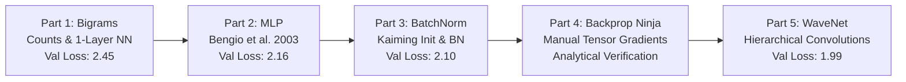

# 🔤 Makemore: Autoregressive Language Modeling from Scratch

[](https://www.python.org/)
[](https://pytorch.org/)
[](https://github.com/karpathy/makemore)
[](../LICENSE)

> An in-depth, step-by-step evolution of **autoregressive character-level language models**, journeying from simple 2D frequency counting to deep Multilayer Perceptrons, manual tensor backpropagation ("Backprop Ninja"), and hierarchical WaveNet-style convolutional architectures.

---

## 📌 Table of Contents

- [Overview](#-overview)
- [The Dataset](#-the-dataset)
- [Architectural Evolution & Performance Benchmarks](#-architectural-evolution--performance-benchmarks)
- [Detailed Notebook Walkthroughs](#-detailed-notebook-walkthroughs)
  - [Part 1: Bigram Language Models](#part-1-bigram-language-models-makemore_part1_bigramsipynb)
  - [Part 2: Multilayer Perceptron (MLP)](#part-2-multilayer-perceptron-mlp-makemore_part2_mlpipynb)
  - [Part 3: Activations, Gradients & Batch Normalization](#part-3-activations-gradients--batch-normalization-makemore_part3_bnipynb)
  - [Part 4: Becoming a Backprop Ninja](#part-4-becoming-a-backprop-ninja-makemore_part4_backpropipynb)
  - [Part 5: WaveNet & Hierarchical Dilated Convolutions](#part-5-wavenet--hierarchical-dilated-convolutions-makemore_part5_cnn1ipynb)
- [Sampling & Qualitative Comparison](#-sampling--qualitative-comparison)
- [How to Run & Dataset Setup](#-how-to-run--dataset-setup)
- [Key Deep Learning Lessons & Engineering Insights](#-key-deep-learning-lessons--engineering-insights)

---

## 🔍 Overview

**Makemore** takes one input text file and models the probability distribution of characters conditioned on preceding context characters:

$$P(c_1, c_2, \dots, c_T) = \prod_{t=1}^T P(c_t \mid c_{t-1}, c_{t-2}, \dots, c_{t-k})$$

Once trained, it samples new sequences autoregressively token-by-token. 

Across the 5 notebooks in this directory, we progressively build and optimize increasingly sophisticated neural architectures, analyzing the mathematics of loss functions, weight initializations, gradient dynamics, and modular layer abstractions.



---

## 📂 The Dataset

The model is trained on [`names.txt`](names.txt), containing **32,033 names** extracted from US Social Security Administration baby name records.
- **Shortest name length:** 2 characters (`an`, `ia`, `bo`, ...)
- **Longest name length:** 15 characters (`muhammadibrahim`)
- **Vocabulary:** 26 lowercase English letters (`a-z`) plus 1 special delimiter token (`.`) representing start/end of sequence (total **27 tokens**).

---

## 📊 Architectural Evolution & Performance Benchmarks

Below is the empirical progression achieved across all 5 notebooks:

| Part | Model Architecture | Context Size | Parameters | Train Loss | Val Loss | Key Highlight |
|---|---|:---:|:---:|:---:|:---:|---|
| **Baseline** | Uniform Random Guessing | - | - | 3.296 | 3.296 | $-\ln(1/27) \approx 3.296$ |
| **Part 1** | Bigram Count Matrix | 1 char | 729 | 2.454 | 2.454 | Statistical count matrix with Laplace smoothing ($+1$) |
| **Part 1** | Bigram Linear Neural Net | 1 char | 729 | 2.470 | 2.470 | Single linear layer + Softmax + NLL Loss |
| **Part 2** | Multilayer Perceptron (MLP) | 3 chars | ~3.4K | 2.124 | 2.168 | Bengio 2003 embeddings + $\tanh$ hidden layer |
| **Part 3** | MLP + Kaiming Init + Fix Saturated Tanh | 3 chars | ~12K | 2.036 | 2.103 | Eliminated dead neurons & hockey-stick loss |
| **Part 3** | MLP + Batch Normalization | 3 chars | ~12.5K | 2.066 | 2.105 | Custom `BatchNorm1d` + running stats |
| **Part 4** | Backprop Ninja MLP | 3 chars | ~12.5K | 2.070 | 2.109 | 100% manual tensor gradients ($\text{diff} < 10^{-7}$) |
| **Part 5** | WaveNet (Hierarchical Conv) | 8 chars | 22K | 1.918 | 2.022 | Consecutive token grouping ($8 \to 4 \to 2 \to 1$) |
| **Part 5** | Scaled WaveNet (`d=24, h=128`) | 8 chars | 76.5K | **1.769** | **1.993** | Broke the 2.0 loss barrier! |

---

## 📓 Detailed Notebook Walkthroughs

### Part 1: Bigram Language Models ([`makemore_part1_bigrams.ipynb`](makemore_part1_bigrams.ipynb))
*The bridge between classical statistics and gradient-based neural networks.*

- **The Statistical Counting Method:**
  - Computes co-occurrence frequencies of character bigrams $(c_1, c_2)$ into a $27 \times 27$ matrix $N$.
  - Converts counts to probabilities: $P_{i,j} = \frac{N_{i,j}}{\sum_k N_{i,k}}$.
  - Introduces **model smoothing (Laplace smoothing)** by adding pseudo-counts ($N + 1$) to prevent infinite loss on unseen bigrams ($\ln(0) = -\infty$).
  - Evaluates loss using Negative Log Likelihood (NLL):
    
    $$\text{NLL} = -\frac{1}{N} \sum_{i=1}^N \ln P(y_i \mid x_i)$$
    
  - Reaches average NLL of **2.454**.
- **The Neural Network Formulation:**
  - One-hot encodes the current character into a 27-dimensional vector $\mathbf{x}$.
  - Computes logits via a single linear weight matrix $W \in \mathbb{R}^{27 \times 27}$: $\mathbf{z} = \mathbf{x} W$.
  - Passes logits through the **Softmax function** to produce a valid probability distribution:
    
    $$P(y = j \mid \mathbf{x}) = \frac{e^{z_j}}{\sum_k e^{z_k}}$$
    
  - Computes NLL loss and adds L2 regularization ($0.01 \cdot W^2$).
  - Backpropagates with PyTorch autograd and updates $W$ with gradient descent.
  - **Core Finding:** The neural network converges to the exact same loss (~2.47) and probability distribution as the statistical counting matrix, proving that linear neural networks optimize empirical frequency counts!

---

### Part 2: Multilayer Perceptron (MLP) ([`makemore_part2_mlp.ipynb`](makemore_part2_mlp.ipynb))
*Implementing Yoshua Bengio et al.'s seminal 2003 paper.*

- **Overcoming the Bigram Limitation:**
  - A bigram model only conditions on 1 preceding character. Expanding a count table to 3 or 5 characters causes an exponential combinatorial explosion ($27^3 = 19,683$, $27^5 = 14,348,907$).
  - Instead, we embed characters into a dense continuous space.
- **Architecture:**
  - **Context window:** 3 characters (`block_size = 3`).
  - **Embedding Table:** $C \in \mathbb{R}^{27 \times d}$ (e.g. $d = 2$ for 2D visualization, $d = 10$ for performance).
  - **Flattening:** Concatenates 3 token embeddings into a vector of length $3 \cdot d$.
  - **Hidden Layer:** $h = \tanh(X_{\text{emb}} W_1 + b_1)$ with 100 or 200 neurons.
  - **Output Layer:** $\text{logits} = h W_2 + b_2 \in \mathbb{R}^{B \times 27}$.
  - **Loss:** `F.cross_entropy(logits, Y)` (combining log-softmax and NLL with numerical stability).
- **Engineering & Optimization Tricks:**
  - **Minibatching:** Batch size of 32 for efficient stochastic gradient descent (SGD).
  - **Learning Rate Finder:** Sweeps learning rates exponentially from $10^{-3}$ to $10^{0}$ using `torch.linspace(-3, 0, 1000)` to plot $\eta$ against loss and pinpoint the optimal step size ($\eta \approx 0.1$).
  - **Splits:** Rigorous 80% train / 10% dev (validation) / 10% test split.
  - **Learning Rate Decay:** Training at $\eta = 0.1$ then decaying to $0.01$ when plateauing.
- **Visualization:**
  - Projects the 2D character embedding space $C$, visually demonstrating how the model clusters vowels (`a`, `e`, `i`, `o`, `u`) together and isolates rare characters (`q`).

---

### Part 3: Activations, Gradients & Batch Normalization ([`makemore_part3_bn.ipynb`](makemore_part3_bn.ipynb))
*Demystifying neural network dynamics, dead neurons, and internal covariate shift.*

- **Diagnosing Bad Initializations:**
  - **Problem 1: Confidently Wrong Outputs ("Hockey Stick" Loss)**
    - Initial loss was $\approx 27.8$, whereas a random guess yields $-\ln(1/27) \approx 3.29$. The model was wasting thousands of steps merely unlearning its initial overconfident wrong predictions.
    - *Fix:* Initialize final layer bias $b_2 = 0$ and scale down $W_2 \times 0.01$. Initial loss drops immediately to $\approx 3.29$, and training begins improving right away.
  - **Problem 2: Saturated $\tanh$ & "Dead" Neurons**
    - The derivative of $\tanh$ is $1 - \tanh^2(x)$. When pre-activations are large ($\pm 15$), $\tanh(x) \approx \pm 1.0$, making the gradient $0.0$.
    - Neurons with flat gradients stop learning permanently.
    - *Fix:* **Kaiming / He Normal Initialization** (He et al., 2015). Scales weights by $\text{gain} / \sqrt{\text{fan\_in}} = \frac{5/3}{\sqrt{\text{fan\_in}}}$.
- **Diagnostic Histograms:**
  - Plots activation distributions, gradient flows, and the **update-to-data ratio** ($\frac{\text{std}(\Delta W)}{\text{std}(W)} \approx 10^{-3}$) across training.
- **Implementing Batch Normalization from Scratch (`BatchNorm1d`):**
  - Normalizes hidden layer pre-activations across the batch dimension:
    
    $$\mu_B = \frac{1}{B} \sum_{i=1}^B x_i, \quad \sigma_B^2 = \frac{1}{B} \sum_{i=1}^B (x_i - \mu_B)^2$$
    
    $$\hat{x}_i = \frac{x_i - \mu_B}{\sqrt{\sigma_B^2 + \epsilon}}$$
    
  - Applies learnable scale ($\gamma$) and shift ($\beta$):
    
    $$y_i = \gamma \hat{x}_i + \beta$$
    
  - Maintains **running mean** and **running variance** using exponential moving average ($0.1$ momentum) for evaluation mode (`training=False`).
- **Modular PyTorch-like Layer Design:**
  - Implements custom `Linear`, `BatchNorm1d`, and `Tanh` classes with `.parameters()` interfaces.

---

### Part 4: Becoming a Backprop Ninja ([`makemore_part4_backprop.ipynb`](makemore_part4_backprop.ipynb))
*Ripping open PyTorch autograd and deriving full tensor backpropagation by hand.*

- **The Challenge:**
  - Forward pass decomposed into 16 micro-operations without calling `.backward()`.
- **Manual Gradient Derivations:**
  - **Exercise 1: Step-by-Step Backpropagation:**
    - Explicitly computes `dlogprobs`, `dcounts_sum`, `dcounts`, `dnorm_logits`, `dlogits`, `dh`, `dhprebn`, `dbngain`, `dbnbias`, `dbnraw`, `dbnvar_inv`, `dbnvar`, `dbndiff`, `dbnmeani`, `dhpreact`, `dW1`, `db1`, `dembcat`, `demb`, `dC`.
  - **Exercise 2: Analytical Cross-Entropy Gradient in One Shot:**
    - Mathematically derives the elegant shortcut for Softmax + Cross Entropy:
      
      $$\frac{\partial L}{\partial z_i} = P_i - \mathbb{I}(y = i)$$
      
      where $P_i = \text{softmax}(z_i)$ and $\mathbb{I}$ is the indicator function.
  - **Exercise 3: Analytical Batch Normalization Gradient in One Shot:**
    - Derives the full multivariate tensor calculus gradient through mean and variance:
      
      $$\frac{\partial L}{\partial x_i} = \frac{\gamma}{B \sqrt{\sigma^2 + \epsilon}} \left( B \frac{\partial L}{\partial y_i} - \sum_{j=1}^B \frac{\partial L}{\partial y_j} - \hat{x}_i \sum_{j=1}^B \frac{\partial L}{\partial y_j} \hat{x}_j \right)$$
      
  - **Exercise 4: The Pure-Numpy-Style Training Loop:**
    - Integrates the analytical gradients into a high-speed training loop running without PyTorch autograd.
- **Verification (`cmp` function):**
  - Compares every single manual tensor gradient against PyTorch's native `.grad`:
    
    ```python
    def cmp(s, dt, t):
        exact = torch.all(dt == t.grad).item()
        approx = torch.allclose(dt, t.grad)
        maxdiff = (dt - t.grad).abs().max().item()
        print(f'{s:15s} | exact: {str(exact):5s} | approx: {str(approx):5s} | maxdiff: {maxdiff}')
    ```
    
  - Confirms that `maxdiff < 1e-7` across all parameters!

---

### Part 5: WaveNet & Hierarchical Dilated Convolutions ([`makemore_part5_cnn1.ipynb`](makemore_part5_cnn1.ipynb))
*Scaling context from 3 tokens to 8 tokens with tree-like dilated convolutions.*

- **The Information Bottleneck in Flat MLPs:**
  - In Part 2 & 3, all context characters were flattened into a single vector immediately in the first layer. A single linear layer had to process all tokens at once with no intermediate abstractions.
- **The WaveNet Solution (van den Oord et al., 2016):**
  - Expands context window to **8 characters** ($2^3 = 8$).
  - Instead of flattening everything at once, groups **2 consecutive token representations** at each layer:
    
    ```
    Level 0 (Input):   [c0] [c1]   [c2] [c3]   [c4] [c5]   [c6] [c7]   (8 characters)
                         \   /       \   /       \   /       \   /
    Level 1:            [  g0  ]    [  g1  ]    [  g2  ]    [  g3  ]   (4 groups)
                            \          /            \          /
    Level 2:               [    h0    ]            [    h1    ]       (2 groups)
                                  \                    /
    Level 3 (Output):            [         logits         ]           (1 prediction)
    ```
    
- **New Modular Components:**
  - `Embedding(num_embeddings, embedding_dim)`: Clean modular embedding lookup.
  - `FlattenConsecutive(n)`: Reshapes tensor dimensions from `(B, T, C)` to `(B, T//n, C*n)`.
  - `BatchNorm1d`: Extended to handle 3D tensors correctly by computing mean and variance across both batch ($B$) and sequence ($T$) dimensions.
  - `Sequential`: Chains layers together and coordinates `.parameters()`.
- **Results:**
  - Context window 8 with 22K parameters achieves **2.022** validation loss.
  - Scaled WaveNet (`n_embd=24, n_hidden=128`, 76K parameters) achieves **1.993** validation loss, decisively breaking the 2.0 barrier!

---

## 🎲 Sampling & Qualitative Comparison

Here is how model generation quality improves across the course:

| Model | Sample Output | Quality / Coherence |
|---|---|---|
| **Random Guessing** | `qzxvf..jkbwq...` | Completely incoherent gibberish |
| **Bigram (Part 1)** | `mor. anan. kay. ion. k.` | Barely plausible syllables, ends too quickly or repeats |
| **MLP (Part 2 & 3)** | `darian. jada. aliyan. kynlee.` | Plausible English names, recognizable patterns |
| **WaveNet (Part 5)** | `anabel. drayden. kailani. jeremiah.` | Highly realistic, natural cadence, correct gendered naming conventions |

---

## 🚀 How to Run & Dataset Setup

### 1. Ensure `names.txt` is Present
The dataset should be in the `makemore/` folder:

```bash
# If not present, download it directly:
curl -O https://raw.githubusercontent.com/karpathy/makemore/master/names.txt
```

### 2. Launch Jupyter Notebook
```bash
# Start jupyter inside this directory or from the root:
jupyter notebook
```

### 3. Recommended Execution Order:
1. Open [`makemore_part1_bigrams.ipynb`](makemore_part1_bigrams.ipynb) to master count matrices and NLL loss.
2. Open [`makemore_part2_mlp.ipynb`](makemore_part2_mlp.ipynb) to learn embeddings, learning rate sweeps, and splits.
3. Open [`makemore_part3_bn.ipynb`](makemore_part3_bn.ipynb) to study initialization bugs, Kaiming init, and BatchNorm.
4. Open [`makemore_part4_backprop.ipynb`](makemore_part4_backprop.ipynb) to challenge yourself with manual tensor derivatives.
5. Open [`makemore_part5_cnn1.ipynb`](makemore_part5_cnn1.ipynb) to build the hierarchical WaveNet model.

---

## 🧠 Key Deep Learning Lessons & Engineering Insights

1. **Always calculate expected initial loss:** For a classification problem with $V$ classes, initial loss should be $\approx -\ln(1/V)$. If it is much higher (e.g. 27.0 vs 3.29), your network is initialized with extreme overconfidence and will waste epochs unlearning it.
2. **Watch out for saturated activations:** Saturated $\tanh$ outputs ($\pm 1.0$) destroy gradients ($1 - t^2 \to 0$). Always inspect activation histograms and scale initial weights using Kaiming normal init.
3. **Cross-entropy is more than softmax + NLL:** Using `F.cross_entropy` subtracts $\max(\text{logits})$ internally, preventing numerical overflow ($\exp(1000) \to \text{inf}$ or $\text{NaN}$), and provides a mathematically clean gradient ($p_i - y_i$).
4. **Batch Normalization is a stabilizer and regularizer:** It controls activation drift, eliminates sensitivity to weight scale, and adds slight noise due to minibatch statistics.
5. **Hierarchical grouping beats flat concatenation:** For temporal or sequential data, progressive grouping preserves spatial/temporal locality and scales effectively to longer contexts.
