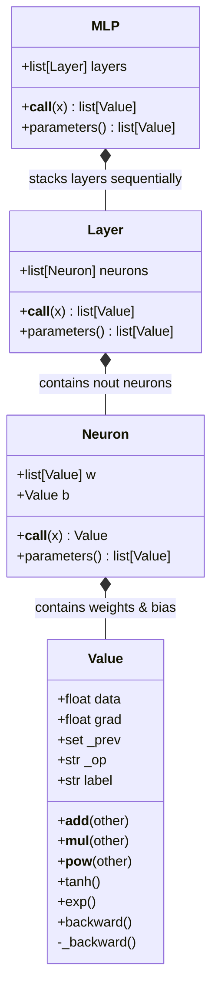

# 🧠 Micrograd: Scalar-Valued Autograd Engine from Scratch

[](https://www.python.org/)
[](https://pytorch.org/)
[](https://graphviz.org/)
[](../LICENSE)

> A first-principles implementation of a **lightweight, scalar-valued automatic differentiation (autograd) engine** with a reverse-mode computational graph and a modular neural network library built completely from scratch.

---

## 📌 Table of Contents

- [Overview](#-overview)
- [Why Scalar Autograd?](#-why-scalar-autograd)
- [Mathematical Foundations](#-mathematical-foundations)
- [Architecture & Design](#-architecture--design)
- [Notebook Walkthroughs](#-notebook-walkthroughs)
  - [Part 1: The Core Autograd Engine & DAG](#part-1-the-core-autograd-engine--dag)
  - [Part 2: Neural Net Primitives & Verification](#part-2-neural-net-primitives--verification)
- [Quickstart & Code Example](#-quickstart--code-example)
- [Computational Graph Visualization](#-computational-graph-visualization)
- [PyTorch Parity Verification](#-pytorch-parity-verification)
- [Key Insights & Common Gotchas](#-key-insights--common-gotchas)

---

## 🔍 Overview

Modern deep learning frameworks like PyTorch and JAX operate on multi-dimensional tensors. While efficient, the tensor operations can obscure what backpropagation actually does under the hood. 

**Micrograd** strips away all abstraction layers:
- Everything operates on simple **Python scalars** (`float`).
- Every mathematical operation dynamically constructs a **Directed Acyclic Graph (DAG)** of computational dependencies.
- Calling `.backward()` traverses this DAG in **reverse topological order**, applying the single-variable and multi-variable chain rule to accumulate partial derivatives (`dL/dx`) for every parameter.
- On top of this scalar engine, we build neural network primitives (`Neuron`, `Layer`, `MLP`) and optimize them with gradient descent to solve non-linear classification problems.

---

## 💡 Why Scalar Autograd?

When you run `loss.backward()` in PyTorch, it traces back thousands of tensor operations in optimized C++/CUDA kernels. By building a scalar autograd engine first:
1. **You see every single chain rule step**: No black-box gradient functions.
2. **You understand gradient accumulation**: Why gradients must be zeroed (`optimizer.zero_grad()`) before each backward pass.
3. **You master topological sorting**: How reverse-mode autodiff orders operations so that dependencies are always computed before their parents.
4. **You connect calculus to code**: See how numerical differentiation ($f'(x) \approx \frac{f(x+h) - f(x)}{h}$) verifies analytical gradients.

---

## 📐 Mathematical Foundations

### 1. Numerical vs. Analytical Gradients

The derivative of a scalar function $f(x)$ with respect to $x$ is defined as:

$$f'(x) = \lim_{h \to 0} \frac{f(x+h) - f(x)}{h}$$

In `micrograd_first_half.ipynb`, we start with a small finite difference step ($h = 10^{-6}$) to estimate derivatives numerically. While intuitive, numerical differentiation scales as $O(N)$ with the number of parameters $N$.

### 2. The Chain Rule & Reverse-Mode Autodiff

Reverse-mode automatic differentiation computes all parameter gradients in a single backward pass ($O(1)$ w.r.t parameter count) by working backwards from the scalar output $L$:

$$\frac{\partial L}{\partial x} = \sum_{y \in \text{children}(x)} \frac{\partial L}{\partial y} \cdot \frac{\partial y}{\partial x}$$

### 3. Gradient Accumulation (Multivariate Chain Rule)

When a variable $x$ is routed to multiple downstream operations (e.g., $z = x + x$ or $z = x \cdot y + x$), the total derivative is the **sum** of the paths:

```python
# CRITICAL: Accumulate with +=, never overwrite with =
self.grad += out.grad * (other.data)
```

If we wrote `=`, gradients would be overwritten rather than summed, breaking the multivariable chain rule.

---

## 🏗 Architecture & Design

Micrograd builds an object-oriented hierarchy of deep learning components:



---

## 📓 Notebook Walkthroughs

### Part 1: The Core Autograd Engine & DAG
📄 **File:** [`micrograd_first_half.ipynb`](micrograd_first_half.ipynb)

- **Numerical Intuition:**
  - Explores quadratic functions $f(x) = 3x^2 - 4x + 5$ and multi-input expressions $d = a \cdot b + c$.
  - Uses finite differences ($h = 0.0001$) to visualize how nudging inputs affects output.
- **The `Value` Object:**
  - Encapsulates scalar `.data` and `.grad` (initialized to `0.0`).
  - Stores child pointers in `_prev` set and tracking operation symbols (`+`, `*`, etc.).
- **Computational Graph Visualization:**
  - Implements `trace()` and `draw_dot()` using Graphviz to render visual computational DAGs showing values, operations, and backpropagated gradients.
- **Manual Backpropagation on a Neuron:**
  - Implements a single biological-inspired neuron:
    
    $$n = x_1 w_1 + x_2 w_2 + b, \quad o = \tanh(n)$$
    
  - Manually derives the derivative of $\tanh$:
    
    $$\frac{d}{dx}\tanh(x) = 1 - \tanh^2(x) = 1 - o^2$$
    
  - Hand-calculates gradients: $\frac{\partial o}{\partial n} = 1 - o^2$, $\frac{\partial o}{\partial w_1} = x_1 \cdot \frac{\partial o}{\partial n}$, $\frac{\partial o}{\partial x_1} = w_1 \cdot \frac{\partial o}{\partial n}$.
- **Automating Backpropagation:**
  - Encapsulates local chain rules inside `_backward()` lambda/closures for each operator.
  - Implements recursive topological sorting via Depth-First Search (DFS) in `build_topo()`:
    
    ```python
    topo = []
    visited = set()
    def build_topo(v):
        if v not in visited:
            visited.add(v)
            for child in v._prev:
                build_topo(child)
            topo.append(v)
    ```
    
  - Setting seed gradient $o.\text{grad} = 1.0$ and calling `_backward()` in `reversed(topo)`.

---

### Part 2: Neural Net Primitives & Verification
📄 **File:** [`micrograd__second_half_roughly.ipynb`](micrograd__second_half_roughly.ipynb)

- **Completing the `Value` Operator Library:**
  - Implements `__radd__`, `__rmul__`, `__sub__`, `__truediv__`, `__pow__`, and `__neg__` to enable idiomatic Python arithmetic (e.g., `2 * x`, `x - y`, `x / y`).
- **Building Neural Network Modules:**
  - **`Neuron(nin)`:** Initializes weights $w_i \sim U(-1, 1)$ and bias $b \sim U(-1, 1)$. Computes $\tanh(\sum w_i x_i + b)$.
  - **`Layer(nin, nout)`:** Creates a layer of independent neurons receiving the same input.
  - **`MLP(nin, [nouts])`:** Sequentially connects layers (e.g., `MLP(3, [4, 4, 1])` = 3 inputs $\to$ 4 neurons $\to$ 4 neurons $\to$ 1 output scalar).
- **The Optimization Loop:**
  - Toy binary classification dataset:
    - 4 input vectors: `xs = [[2.0, 3.0, -1.0], [3.0, -1.0, 0.5], [0.5, 1.0, 1.0], [1.0, 1.0, -1.0]]`
    - Target labels: `ys = [1.0, -1.0, -1.0, 1.0]`
  - Standard deep learning optimization cycle:
    1. **Forward pass:** `ypred = [n(x) for x in xs]`
    2. **Loss computation:** Mean Squared Error:
       
       $$\text{Loss} = \sum (y_{\text{pred}} - y_{\text{true}})^2$$
       
    3. **Zero gradients:** `for p in n.parameters(): p.grad = 0.0`
    4. **Backward pass:** `loss.backward()`
    5. **Gradient descent step:** `for p in n.parameters(): p.data += -step_size * p.grad`
  - Demonstrates loss decreasing smoothly from `~6.3` to `~0.0001` with predictions converging to target values.
- **PyTorch Parity Check:**
  - Constructs the exact same neuron in PyTorch using `torch.Tensor(requires_grad=True).double()`.
  - Runs `.backward()` and verifies bit-for-bit gradient match between Micrograd and PyTorch.

---

## 🚀 Quickstart & Code Example

### 1. Minimal Implementation

Here is how you can define an expression, compute gradients, and train an MLP using the components created in these notebooks:

```python
import random
import math

class Value:
    def __init__(self, data, _children=(), _op='', label=''):
        self.data = data
        self.grad = 0.0
        self._backward = lambda: None
        self._prev = set(_children)
        self._op = _op
        self.label = label

    def __add__(self, other):
        other = other if isinstance(other, Value) else Value(other)
        out = Value(self.data + other.data, (self, other), '+')
        def _backward():
            self.grad += 1.0 * out.grad
            other.grad += 1.0 * out.grad
        out._backward = _backward
        return out

    def __mul__(self, other):
        other = other if isinstance(other, Value) else Value(other)
        out = Value(self.data * other.data, (self, other), '*')
        def _backward():
            self.grad += other.data * out.grad
            other.grad += self.data * out.grad
        out._backward = _backward
        return out

    def tanh(self):
        x = self.data
        t = (math.exp(2*x) - 1) / (math.exp(2*x) + 1)
        out = Value(t, (self,), 'tanh')
        def _backward():
            self.grad += (1 - t**2) * out.grad
        out._backward = _backward
        return out

    def backward(self):
        topo = []
        visited = set()
        def build_topo(v):
            if v not in visited:
                visited.add(v)
                for child in v._prev:
                    build_topo(child)
                topo.append(v)
        build_topo(self)
        self.grad = 1.0
        for node in reversed(topo):
            node._backward()
```

### 2. Training a Multi-Layer Perceptron

```python
# 1. Instantiate a 2-layer MLP (3 inputs -> 4 hidden -> 4 hidden -> 1 output)
model = MLP(3, [4, 4, 1])

# 2. Dataset
xs = [
    [2.0, 3.0, -1.0],
    [3.0, -1.0, 0.5],
    [0.5, 1.0, 1.0],
    [1.0, 1.0, -1.0]
]
ys = [1.0, -1.0, -1.0, 1.0]

# 3. Training Loop
for epoch in range(50):
    # Forward pass
    ypred = [model(x) for x in xs]
    loss = sum((yout - ygt)**2 for ygt, yout in zip(ys, ypred))
    
    # Zero gradients
    for p in model.parameters():
        p.grad = 0.0
        
    # Backward pass
    loss.backward()
    
    # Gradient descent update
    learning_rate = 0.05
    for p in model.parameters():
        p.data -= learning_rate * p.grad

print("Final Loss:", loss.data)
print("Predictions:", [round(yp.data, 4) for yp in ypred])
```

---

## 📊 Computational Graph Visualization

In `micrograd_first_half.ipynb`, we implement `draw_dot(root)` using `graphviz`. It renders every node with:
- The variable label (e.g. `w1`, `x1`, `b`)
- The scalar value (`data: ...`)
- The accumulated derivative (`grad: ...`)
- The operation that generated it (e.g. `+`, `*`, `tanh`)

```
 [x1 | data: 2.0 | grad: -1.5]
             \
              (*) ---> [x1*w1 | data: -6.0 | grad: 0.5]
             /                                         \
 [w1 | data: -3.0 | grad: 1.0]                          (+) ---> [n | data: 0.88] ---> (tanh) ---> [o | data: 0.707]
                                                       /
 [b  | data: 6.88 | grad: 0.5] ------------------------
```

---

## 🔬 PyTorch Parity Verification

In `micrograd__second_half_roughly.ipynb`, we verify Micrograd's exactness against PyTorch:

```python
import torch

# Micrograd
x1 = Value(2.0, label='x1')
x2 = Value(0.0, label='x2')
w1 = Value(-3.0, label='w1')
w2 = Value(1.0, label='w2')
b = Value(6.8813735870195432, label='b')
x1w1 = x1 * w1; x2w2 = x2 * w2
x1w1x2w2 = x1w1 + x2w2
n = x1w1x2w2 + b
o = n.tanh()
o.backward()

# PyTorch
x1_pt = torch.Tensor([2.0]).double(); x1_pt.requires_grad = True
x2_pt = torch.Tensor([0.0]).double(); x2_pt.requires_grad = True
w1_pt = torch.Tensor([-3.0]).double(); w1_pt.requires_grad = True
w2_pt = torch.Tensor([1.0]).double(); w2_pt.requires_grad = True
b_pt  = torch.Tensor([6.8813735870195432]).double(); b_pt.requires_grad = True
n_pt  = x1_pt*w1_pt + x2_pt*w2_pt + b_pt
o_pt  = torch.tanh(n_pt)
o_pt.backward()

assert abs(x1.grad - x1_pt.grad.item()) < 1e-12
assert abs(w1.grad - w1_pt.grad.item()) < 1e-12
print("All gradients match PyTorch within float64 machine epsilon!")
```

---

## ⚠️ Key Insights & Common Gotchas

1. **Forgetting to Zero Gradients (`zero_grad`):**
   - Gradients accumulate via `+=`. If you don't reset `p.grad = 0.0` at each iteration, gradients will compound and explode across epochs.
2. **Variable Reuse Bugs:**
   - Writing `self.grad = ...` instead of `self.grad += ...` inside `_backward()` will silently produce incorrect gradients whenever the same variable appears multiple times in a graph (e.g. `a = Value(3.0); b = a + a`).
3. **Graphviz Prerequisites:**
   - The Python `graphviz` package is a wrapper. You must also have the Graphviz system executable installed and available in your `PATH` (see root README setup).
4. **Learning Rate Sensitivity:**
   - In pure gradient descent without momentum or Adam, high learning rates easily cause oscillation. Start with $\eta \in [0.01, 0.1]$.
